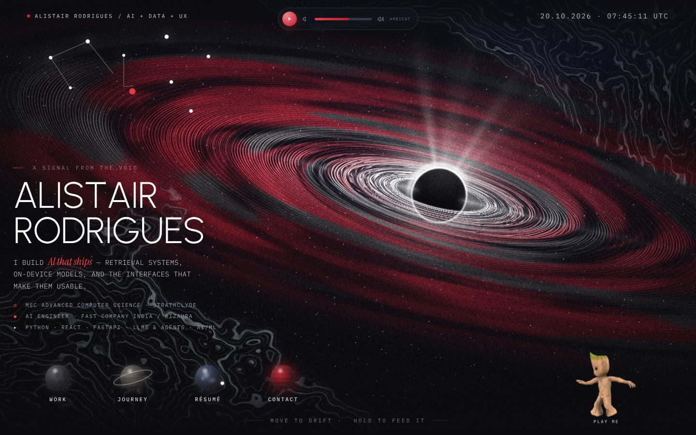
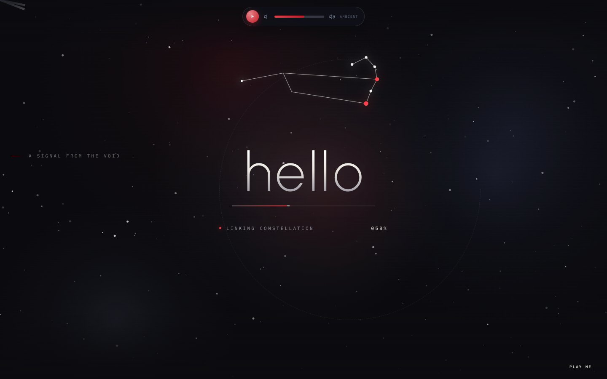
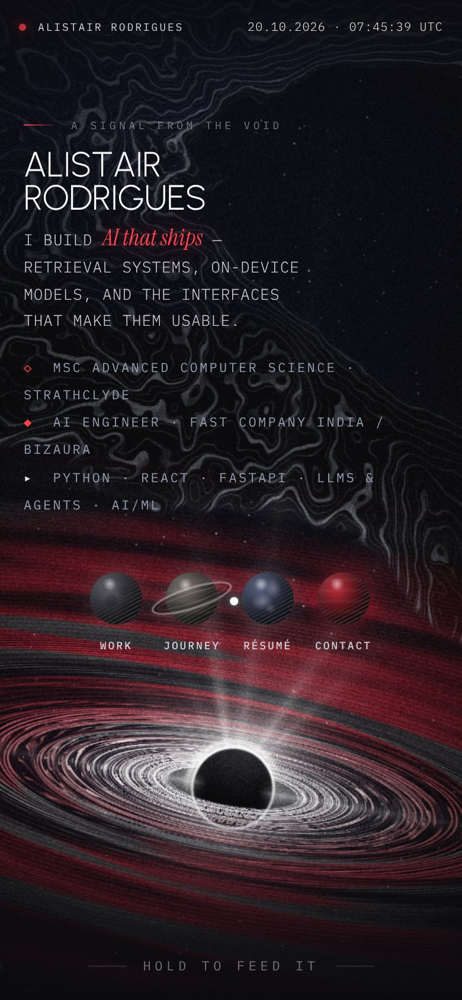
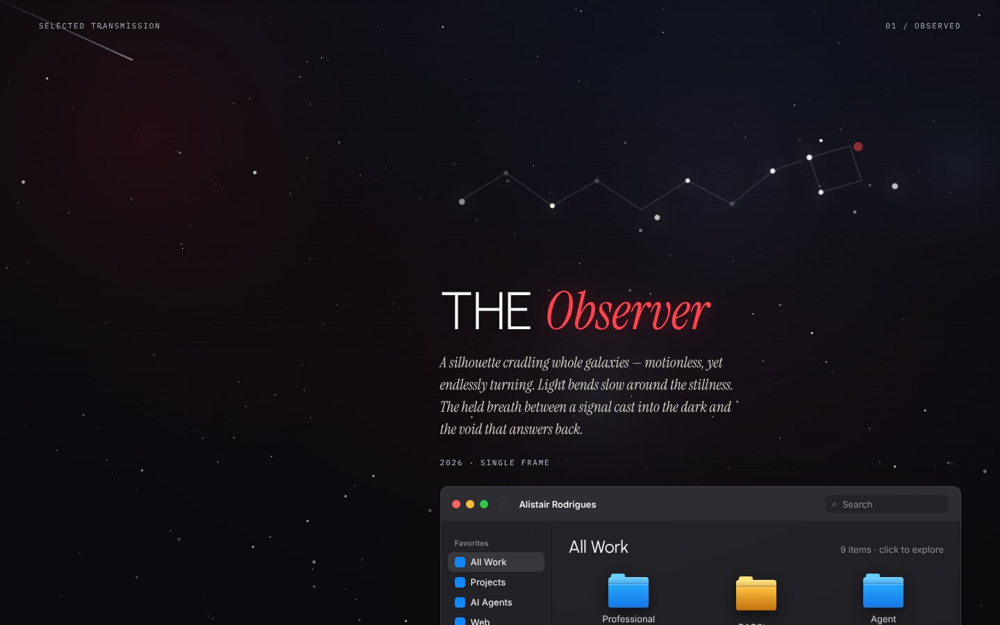
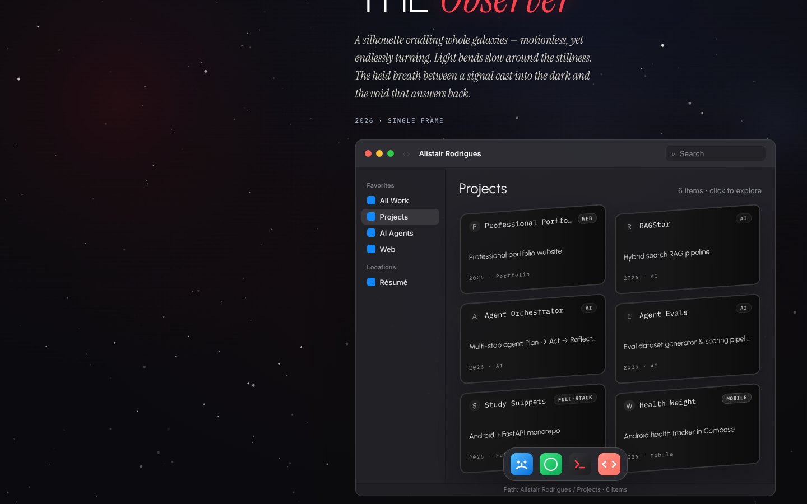
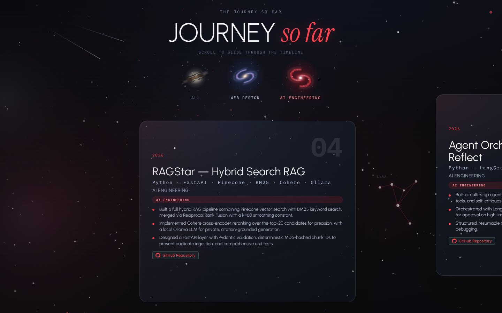
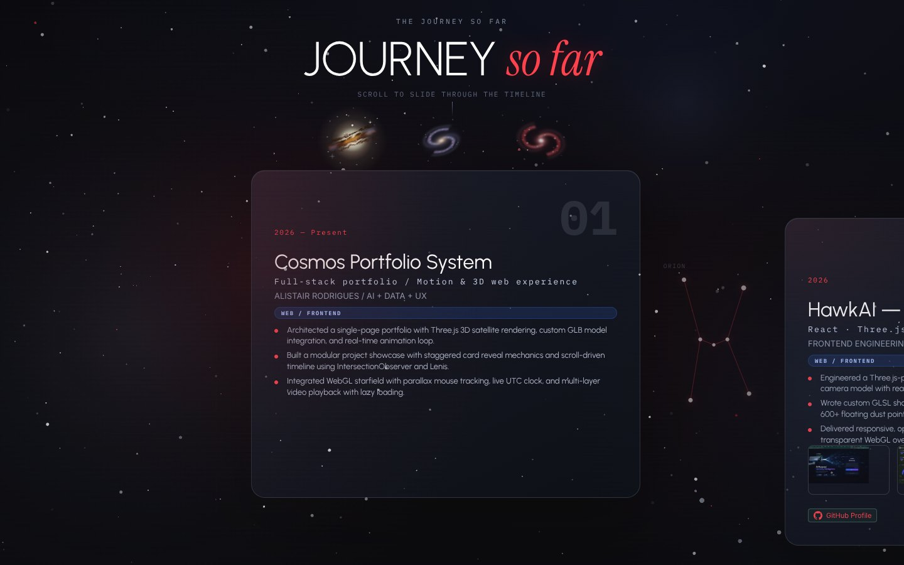
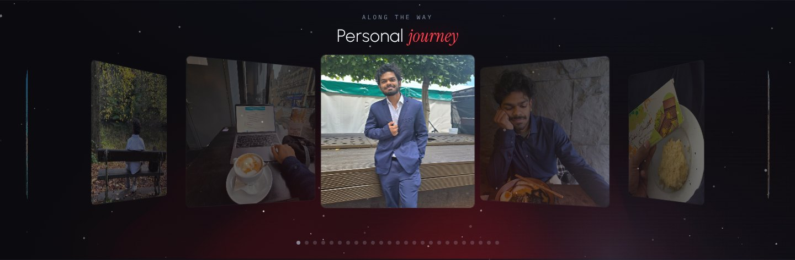
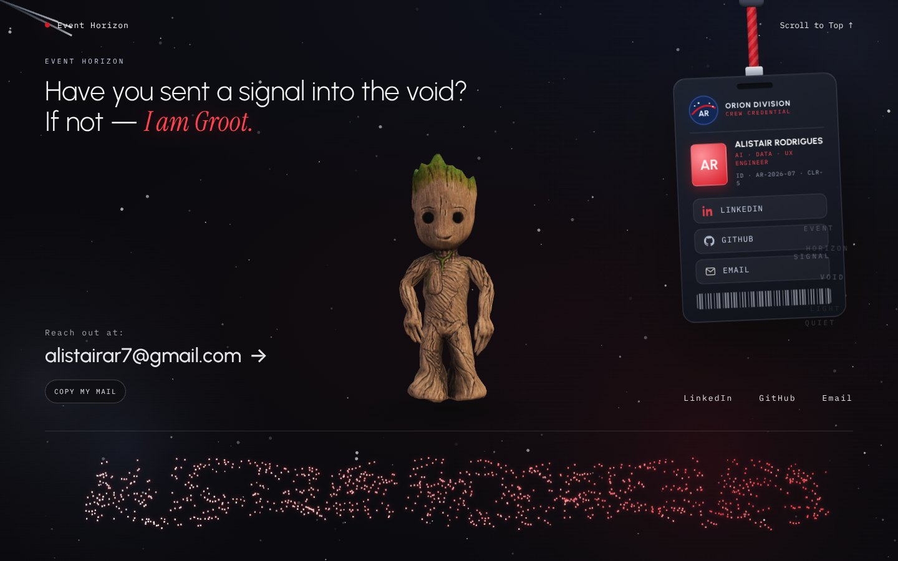

# COSMOS — Portfolio

A signal-based portfolio that feels discovered, not browsed.



## What it is

A single-page portfolio with an engraved deep-space aesthetic — a procedural black hole in the hero, decrypted name reveal, scroll-driven timeline, and live project showcase.

## Sections

> Screenshots are real captures of the current site (desktop at 1440×900, phone at 390×844).

### Intro — "hello"
The loader draws the Leo constellation as the page actually loads, with a hairline crimson progress bar and live status ("Acquiring signal → Linking constellation → Signal locked").



### Hero — Etched Accretion
A black hole drawn like an engraving: hair-thin orbital streaks banded in crimson, a photon crown, contour-line nebula and film grain — one procedural WebGL2 shader. Move the pointer for parallax, hold to feed it. Around it: the decrypted name reveal, live UTC clock, ambient music player, the Taurus constellation, planet nav (Work · Journey · Résumé · Contact) and a dancing "play me" Groot that starts the Awesome Mix. *(Screenshot at the top of this page.)*

<p align="center"></p>
<p align="center"><sub>On phones the black hole sits below the copy and planet nav.</sub></p>

### Perspective Marquee
A scrolling brand marquee (Vercel, Linear, Stripe…) on a 3D tilt.

### The Observer — selected work
A poetic intro over the starfield, then a macOS-style Finder window. The front views (**All Work**, **Projects**) lead with the Professional Portfolio and the AI projects; other web work sits behind the **Web** tab. Also **AI Agents** (an interactive architecture map) and **Résumé**, with Quick Look previews. Repositories tagged `portfolio` on GitHub appear automatically (web repos under Web).




### Journey So Far
Pick a galaxy — **All**, **Web Design** or **AI Engineering** — and the timeline opens as horizontally scrolling project cards (stack, highlights, screenshots, GitHub links), linked by constellations.




### Personal Journey
A coverflow carousel of photos from along the way.



### Event Horizon — contact
Contact details, a swinging (draggable) crew-credential badge with LinkedIn / GitHub / Email, a dancing 3D Groot, and a particle-text signature that scatters around the cursor.



## Projects in `work/`

| Project | Stack | Description |
|---------|-------|-------------|
| **HawkAI Login** | React 19, Three.js, Ant Design, Vite 8 | 3D security camera login experience with GLSL shader ribbons |
| **Quantasphere Hero** | Vanilla HTML/CSS/JS | Interactive hero with cursor-driven video scrubbing |
| **RAGStar** | Python, FastAPI, Pinecone, BM25, Cohere, Ollama | Hybrid search RAG with vector + keyword fusion via RRF |
| **Study Snippets** | Kotlin, Jetpack Compose, FastAPI, Supabase, Docker | Full-stack monorepo: Android app + Python backend |
| **Health Weight App** | Kotlin, Jetpack Compose, Material Design, Gradle | Android health and weight tracking app |

## Run it

```bash
python3 -m http.server 4521
```

Open http://localhost:4521 — no build step needed for the main page. For HawkAI, navigate to `/work/hawkai-login-showcase/`.

## Recent GitHub Repos

All projects linked from the portfolio are hosted on GitHub:
- [github.com/Alistair77/ragstar](https://github.com/Alistair77/ragstar) — Hybrid Search RAG System
- [github.com/Alistair77/study_snipp](https://github.com/Alistair77/study_snipp) — Full-stack study monorepo
- [github.com/Alistair77/health-weight-app-compose](https://github.com/Alistair77/health-weight-app-compose) — Android health tracker
- [github.com/Alistair77/AAPL_stock_prediction-2024](https://github.com/Alistair77/AAPL_stock_prediction-2024) — Apple stock prediction (Jupyter Notebook)
- [github.com/Alistair77](https://github.com/Alistair77) — Full GitHub profile

## Theme

The whole site takes its palette and voice from the hero black hole:

| Token | Value | Use |
|-------|-------|-----|
| `--bg` | `#030307` | deep space, every section |
| `--silver` | `#e9e4df` | disk streaks — secondary ink, clock |
| `--cloud` | `#c9d0e2` | nebula contour lines — hairlines |
| `--crimson` / `--crimson-hi` | `#d3121f` / `#ff3b47` | the one accent (fills & glows / text) |

Type: **Urbanist** (light display), **Instrument Serif** italic for the single crimson accent word in each headline (`.etch-accent`), **IBM Plex Mono** for labels. A fixed film-grain layer (`.page-grain`) sits over everything. Project category chips reuse the component's presets: web = glacier, AI = crimson, full-stack = orchid, mobile = ember.

## Hero black hole — `etched-accretion.js`

A vanilla ES-module port of the `EtchedAccretion` React component (no build step needed): one full-screen WebGL2 fragment shader, no textures or network assets. It adapts its resolution on slow GPUs, pauses when off-screen, recovers from context loss, draws a single still frame under `prefers-reduced-motion`, and falls back to a CSS sketch without WebGL2.

```js
import { mountEtchedAccretion } from './etched-accretion.js'
const bh = mountEtchedAccretion(el, { preset: 'crimson', params: { center: [0.63, 0.45] }, root: heroSection })
bh.setParams({ holeSize: 0.07 })   // retune live; presets: crimson · ember · glacier · ash · orchid
bh.setPaused(false)                // pass { paused: true } to compile now and animate later
```

The hero mounts it from the module at the bottom of `index.html`; desktop/phone placement lives in its `layout()`.

## Performance rules

Keep these when adding effects — breaking any one of them is what made the page feel heavy:

- **Only what is on screen animates.** Every canvas/WebGL loop, the SVG galaxies and the Observer video pause via `IntersectionObserver` when out of view. The hero shader is held during the intro and the starfield skips frames while the opaque hero fills the screen.
- **Heavy libraries load on demand.** three.js (footer Groot) loads when the footer is a screen away; model-viewer (hero "play me" Groot) loads after the intro when the browser is idle, and not at all on phones.
- **Cap pixel density.** Drawing buffers stop at 1.5×; soft layers (journey particles, waves) render at 1× and the footer Prism at 0.4× / 30fps — they are blurs, so nobody can tell.
- **No per-frame filters on moving content.** No `backdrop-filter` over the animated starfield and no CSS `drop-shadow` on live canvases — glows are static gradients. Batch canvas draws (one fill per colour bucket) instead of one draw — or one `shadowBlur` — per particle.

## Stack

- Custom DC runtime (`support.js`)
- WebGL2 shader for the hero black hole (`etched-accretion.js`)
- Three.js + model-viewer (Groot)
- Lenis (smooth scroll)
- Google Fonts: Urbanist, Instrument Serif, IBM Plex Mono
